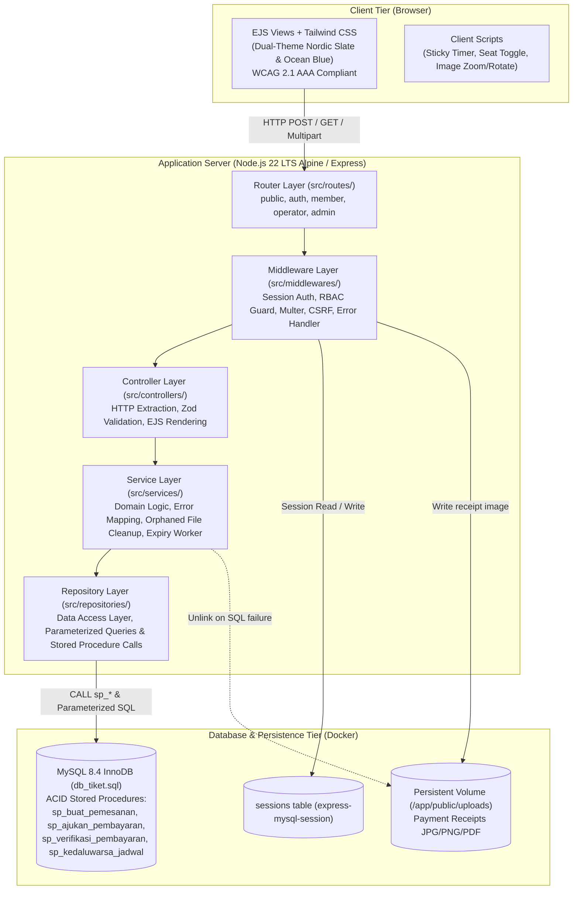
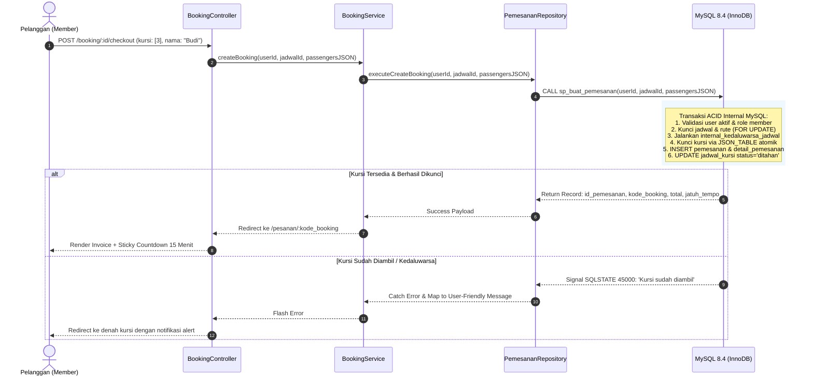
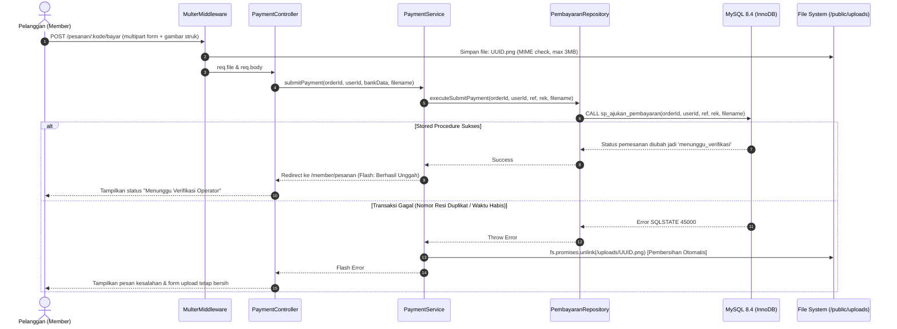
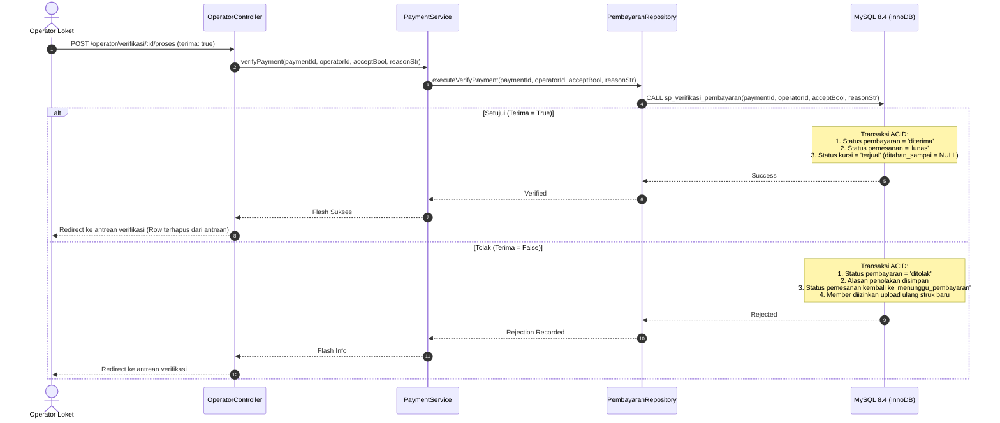

# Sistem Pemesanan Tiket Travel (Node.js + Tailwind CSS + MySQL 8.4 Docker)

* **Author:** Mahasiswa & Antigravity Pair
* **Status:** Draft
* **Date:** 2026-10-30

--------------------------------------------------------------------------------

## Overview

Sistem Pemesanan Tiket Travel adalah aplikasi web berbasis kontainer (Docker) yang melayani pemesanan tiket travel antarkota untuk 3 peran: **Admin**, **Operator Loket**, dan **Member/Pelanggan**. Sistem ini mengonsumsi skema ter-normalisasi MySQL 8.4 InnoDB pada `db_tiket.sql` tanpa merubah struktur tabel maupun data historis. Seluruh alur transaksi diisolasi menggunakan *stored procedures* transaksi ACID bawaan database, disajikan melalui antarmuka responsif **Tailwind CSS** dengan standar aksesibilitas **WCAG 2.1 Level AA & AAA** dan sistem tema ganda (*Nordic Slate & Ocean Blue*).

---

## The Problem

Sistem pemesanan travel antarkota menghadapi tantangan operasional dan teknis yang signifikan:
1. **Risiko Double-Booking pada Kapasitas Terbatas**: Armada mobil travel minibus hanya memiliki 5 kursi per perjalanan. Jika dua pelanggan memilih kursi yang sama secara bersamaan, ketiadaan mekanisme penguncian atomik akan mengakibatkan kursi yang sama terjual ganda.
2. **Keterikatan Skema Database Legacy Ter-normalisasi**: Database `db_tiket.sql` telah mengimplementasikan *stored procedures*, *triggers*, dan *CHECK constraints* yang ketat (misal: aturan bahwa kolom `ditahan_sampai` harus `NULL` saat kursi berstatus `terjual`). Penulisan transaksi ad-hoc manual di layer aplikasi berisiko memicu *deadlock* dan pelanggaran integritas kunci asing sirkular.
3. **Akun Bawaan Belum Memiliki Kata Sandi (*Cold Start*)**: Seluruh akun pengguna hasil migrasi pada `db_tiket.sql` memiliki `password_hash = NULL` dan `wajib_reset_password = 1`. Sistem harus memiliki mekanisme aktivasi atau seeder pengujian tanpa merusak data awal.
4. **Verifikasi Pembayaran Manual**: Sistem mengandalkan transfer bank manual. Tanpa alur verifikasi berkas struk yang terintegrasi dan proteksi *holding timer*, pesanan berisiko kedaluwarsa padahal member telah mentransfer dana.

---

## Goals

* **Kepatuhan Fungsional Penuh**: Mengimplementasikan 11 use case diagram untuk Admin, Operator Loket, dan Member dalam 18 halaman antarmuka terstruktur.
* **Integritas Konkurensi & Transaksi ACID**: Menghubungkan seluruh proses reservasi, konfirmasi, verifikasi, pembatalan, dan *timeout* langsung ke *stored procedures* resmi:
  * `sp_buat_pemesanan` (validasi kursi atomik via `JSON_TABLE`)
  * `sp_ajukan_pembayaran` (penguncian berkas bukti transfer)
  * `sp_verifikasi_pembayaran` (persetujuan/penolakan oleh operator)
  * `sp_kedaluwarsa_jadwal` (pelepasan kursi kedaluwarsa)
  * `sp_batalkan_pemesanan` (pembatalan manual)
* **Antarmuka Ergonomis & Aksesibel**: Desain antarmuka Tailwind CSS memenuhi rasio kontras WCAG 2.1 AAA, ramah buta warna (*non-color status indicators*), keyboard-accessible, dan mendukung mode Gelap/Terang (*Nordic Slate & Ocean Blue*).
* **Penanganan Transaksi Loket Fisik (Walk-in)**: Operator dapat memproses penumpang langsung di loket dengan pembayaran tunai dan penerbitan tiket instan.
* **Portabilitas Kontainer Penuh**: Orkestrasi terpadu via Docker Compose (`app` Node.js 22 LTS Alpine, `db` MySQL 8.4 resmi, dan volume persistensi gambar) siap dijalankan dengan satu perintah.
* **Kesiapan Demonstrasi Akademik**: Menyediakan skrip seeder kredensial akun bawaan (`seedPasswords.ts`) dan jadwal aktif hari ini/besok (`seedDemoSchedules.ts`) agar pengujian di hadapan dosen tidak kosong.

---

## Non-Goals

* **Integrasi Payment Gateway Otomatis**: Tidak menggunakan pihak ketiga (Midtrans, Xendit, dsb.) karena tabel database dirancang untuk transfer manual (`referensi`, `no_rek_pengirim`, `bukti_pembayaran`).
* **Gateway SMS / WhatsApp Fisik**: Notifikasi status tiket disajikan melalui dashboard web dan banner peringatan.
* **Pelacakan Armada Berbasis GPS Real-Time**: Tidak mencakup pelacakan posisi bus/mobil di peta interaktif.
* **Denah Kursi Dinamis > 5 Kursi**: Struktur armada terkunci pada kapasitas minibus 5 kursi sesuai data master `kursi_kendaraan`.

---

## Open Questions

* **Pertanyaan 1 (Strategi Akun Penumpang Walk-in)**: Bagaimana menangani constraint `role = 'member'` pada `sp_buat_pemesanan` untuk penumpang fisik yang datang langsung ke loket?  
  *Resolusi*: Form loket menerima Nama dan No Telepon penumpang, lalu backend secara otomatis mencari atau mendaftarkan akun member instan (*on-the-fly provisioning*) sebelum prosedur reservasi dieksekusi.
* **Pertanyaan 2 (Penanganan Jadwal Historis 2017)**: Data jadwal bawaan bertanggal 2017, bagaimana mencegah katalog kosong saat demo dosen?  
  *Resolusi*: Sediakan toggle konfigurasi `.env` (`DEMO_SHOW_ALL_SCHEDULES=true`) dan skrip CLI `npm run seed:demo-schedules` untuk menyuntikkan jadwal aktif tanggal hari ini dan besok.

---

## Critical User Journeys (CUJs)

### CUJ 1: Member Melakukan Reservasi Kursi & Upload Bukti Pembayaran
* **Given**: Member telah login; jadwal rute travel aktif memiliki kursi berstatus `tersedia`.
* **When**: Member mencari rute, memilih Kursi 3 di denah kabin interaktif, mengisi identitas penumpang, menekan konfirmasi pemesanan, dan mengunggah foto struk transfer sebelum batas waktu 15 menit berakhir.
* **Then**: Prosedur `sp_buat_pemesanan` mengunci kursi (status: `ditahan`), kode booking `TKT-...` diterbitkan, dan `sp_ajukan_pembayaran` mengubah status pesanan menjadi `menunggu_verifikasi` sehingga aman dari pembatalan otomatis.

### CUJ 2: Operator Loket Memverifikasi Pembayaran & Menerbitkan Tiket Lunas
* **Given**: Terdapat pesanan berstatus `menunggu_verifikasi` dengan berkas bukti struk transfer.
* **When**: Operator loket membuka antrean verifikasi pembayaran, mengklik review struk (zoom/rotate gambar), mencocokkan nominal dan nomor resi, lalu menekan tombol "Setujui Pembayaran".
* **Then**: Prosedur `sp_verifikasi_pembayaran` mengubah status pembayaran menjadi `diterima`, status pemesanan menjadi `lunas`, dan status kursi menjadi `terjual` (dengan `ditahan_sampai = NULL`). E-Tiket PDF langsung dapat dicetak.

### CUJ 3: Pemesanan Tiket Offline / Walk-in oleh Petugas Loket (Tunai)
* **Given**: Penumpang datang langsung secara fisik ke loket travel; petugas loket login pada portal operator.
* **When**: Petugas membuka menu pemesanan walk-in, memilih jadwal dan kursi kosong, memasukkan nama dan nomor telepon penumpang, menerima uang tunai, dan menekan "Proses Tiket Walk-in".
* **Then**: Sistem memverifikasi/mendaftarkan akun member instan by no telepon, memanggil `sp_buat_pemesanan`, langsung menandai pembayaran tunai lunas, dan mencetak tiket fisik secara instan.

### CUJ 4: Pelepasan Kursi Otomatis Akibat Pembayaran Kedaluwarsa
* **Given**: Member memesan Kursi 4, status kursi menjadi `ditahan` dengan batas waktu 15 menit (`ditahan_sampai`).
* **When**: Member menutup browser dan tidak menyelesaikan unggah bukti transfer hingga batas 15 menit habis.
* **Then**: Background worker mengeksekusi `CALL sp_kedaluwarsa_jadwal(jadwal_id)`, status pesanan berubah menjadi `kedaluwarsa`, dan Kursi 4 otomatis kembali menjadi `tersedia` bagi penumpang lain.

--------------------------------------------------------------------------------

## Technical Plan (Architecture)

### 1. High-Level Component Architecture

Sistem mengadopsi pola **Modular Layered Architecture (MVC + Service + Repository + Stored Procedures)** untuk memastikan modularitas tinggi, isolasi query database, kemudahan pengujian unit, dan pencegahan *over-engineering*:

---

### 2. Alur Data & Sequence Diagram Transaksi Kritis

#### A. Alur Reservasi Kursi & Checkout (Anti Double-Booking)

#### B. Alur Unggah Bukti Transfer & Proteksi File Sampah

#### C. Alur Verifikasi Pembayaran oleh Operator Loket

---

### 3. Integrasi Skema Database & Isolasi Repository

Seluruh repository di `src/repositories/` dirancang dengan pemisahan tanggung jawab (*Separation of Concerns*):
1. **`pemesanan.repository.ts`**:
   - `createBooking(userId, jadwalId, passengersJSON)` ➔ `CALL sp_buat_pemesanan(?, ?, ?)`
   - `cancelBooking(orderId, userId, reason)` ➔ `CALL sp_batalkan_pemesanan(?, ?, ?)`
   - `getBookingByCode(bookingCode)` ➔ `SELECT ... FROM pemesanan p JOIN detail_pemesanan d ... WHERE p.kode_booking = ?`
   - `getMemberBookings(userId)` ➔ `SELECT ... FROM pemesanan WHERE id_pemesan = ? ORDER BY dibuat_pada DESC`
2. **`pembayaran.repository.ts`**:
   - `submitPaymentProof(orderId, userId, ref, acc, filename)` ➔ `CALL sp_ajukan_pembayaran(?, ?, ?, ?, ?)`
   - `verifyPayment(paymentId, operatorId, isApproved, rejectReason)` ➔ `CALL sp_verifikasi_pembayaran(?, ?, ?, ?)`
   - `getPendingPayments()` ➔ `SELECT ... FROM pembayaran p JOIN pemesanan o ON o.id=p.id_pemesanan WHERE p.status = 'menunggu'`
3. **`jadwal.repository.ts`**:
   - `getActiveSchedules(originCityId, destCityId, dateStr, showHistorical)` ➔ `SELECT ... FROM jadwal j JOIN rute r ... JOIN kendaraan k ...`
   - `getScheduleSeats(jadwalId)` ➔ `SELECT s.id, s.id_kursi, k.nomor, k.urutan, s.status, s.ditahan_sampai FROM jadwal_kursi s JOIN kursi_kendaraan k ON k.id=s.id_kursi WHERE s.id_jadwal = ? ORDER BY k.urutan`
   - `releaseExpiredHolds(jadwalId)` ➔ `CALL sp_kedaluwarsa_jadwal(?)`
4. **`user.repository.ts`**:
   - `findUserByUsernameOrEmail(identifier)` ➔ `SELECT * FROM users WHERE username = ? OR email = ?`
   - `findUserByPhone(phone)` ➔ `SELECT * FROM users WHERE telepon = ?`
   - `createMemberAccount(userData)` ➔ `INSERT INTO users (username, nama, telepon, alamat, jenis_kelamin, role, password_hash, wajib_reset_password) ...`
   - `updatePasswordHash(userId, newHash)` ➔ `UPDATE users SET password_hash = ?, wajib_reset_password = 0 WHERE id = ?`

---

### 4. Topologi Kontainer Docker & Orkestrasi Deployment

File `docker-compose.yml` mengorkestrasi 2 service inti dengan isolasi jaringan dan volume persisten:
* **Service `db`**:
  * Image resmi `mysql:8.4`.
  * Konfigurasi inisialisasi: `./db_tiket.sql:/docker-entrypoint-initdb.d/init.sql:ro`.
  * Persistent volume `db_data:/var/lib/mysql`.
  * `healthcheck`: Pengujian `mysqladmin ping -h localhost` setiap 5 detik untuk memastikan database benar-benar siap menerima koneksi sebelum kontainer aplikasi dinyalakan.
* **Service `app`**:
  * Build dari `Dockerfile` (Node.js 22 LTS Alpine multi-stage build).
  * Menunggu status `db` bernilai `service_healthy` sebelum mengeksekusi `node dist/server.js`.
  * Bind mount `./public/uploads:/app/public/uploads` agar gambar struk pembayaran yang diunggah tetap awet dan tidak terhapus saat kontainer di-*rebuild*.
  * Variabel lingkungan dimuat dari `.env`. Port `3000:3000`.

--------------------------------------------------------------------------------

## Alternatives Considered

### 1. Alternative A: Monolith Framework PHP (Laravel 11 + Blade)
* **Deskripsi Pendekatan**: Membangun aplikasi menggunakan PHP 8.3 dengan framework Laravel 11, memanfaatkan Eloquent ORM dan Blade template.
* **Kelebihan (Pros)**:
  * Sangat familier di lingkungan akademik jurusan IT di Indonesia.
  * Fitur bawaan lengkap out-of-the-box (CSRF, multi-auth guards, Blade components).
* **Kekurangan & Alasan Penolakan (Cons & Why Rejected)**:
  * *Resource Footprint Tinggi*: Image Docker (PHP-FPM + Nginx + Composer) berukuran ~250MB dengan konsumsi RAM idle ~180-250MB, jauh lebih berat dibanding Node.js Alpine (~75MB image, ~50MB RAM).
  * *Friksi Konvensi Skema*: Laravel default mengharapkan tabel `users` memiliki kolom `password` (bukan `password_hash`), serta nama tabel jamak bahasa Inggris. Skema `db_tiket.sql` menggunakan penamaan Indonesia (`id_pemesan`, `bukti_pembayaran`, `password_hash`, `wajib_reset_password`) yang menuntut penulisan override manual pada hampir semua model Eloquent dan custom `UserProvider`.
  * *Kompleksitas Kontainer*: Menjalankan background worker pembatalan tiket 15 menit di Laravel membutuhkan supervisord dan Redis/database queue worker, menambah kompleksitas kontainer Docker.

---

### 2. Alternative B: Decoupled REST API + React/Vue SPA Frontend
* **Deskripsi Pendekatan**: Memisahkan backend murni Express REST API (JSON) dan frontend Single Page Application (SPA) berbasis React/Vite.
* **Kelebihan (Pros)**:
  * Pemisahan mutlak antara logika backend dan antarmuka pengguna.
  * Transisi halaman tanpa reload penuh di sisi klien.
* **Kekurangan & Alasan Penolakan (Cons & Why Rejected)**:
  * *Over-engineering & Plumbing Overhead*: Mengharuskan manajemen 2 kontainer Docker terpisah (Web Server Nginx untuk frontend + Node.js API), penanganan issue CORS, sinkronisasi cookie sesi lintas port, dan state management kompleks (Redux/Zustand).
  * *Kecepatan Implementasi*: Untuk lingkup 18 tampilan use case, arsitektur **Modular Monolith SSR (EJS + Tailwind)** terbukti jauh lebih cepat dibangun, bebas masalah CORS, dan tetap memberikan interaktivitas tinggi dengan skrip Vanilla JS terfokus.

---

### 3. Alternative C: Manual Two-Phase Seat Locking di Layer Aplikasi (TypeScript)
* **Deskripsi Pendekatan**: Mengabaikan stored procedure database dan mengeksekusi penguncian kursi via rangkaian query manual di Node.js (`START TRANSACTION` -> `SELECT FOR UPDATE` -> `INSERT detail` -> `UPDATE kursi`).
* **Kelebihan (Pros)**:
  * Seluruh alur logika ditulis di dalam kode TypeScript aplikasi.
* **Kekurangan & Alasan Penolakan (Cons & Why Rejected)**:
  * *Risiko Deadlock & Constraint Violation*: Skema `db_tiket.sql` memiliki relasi foreign key sirkular `fk_alokasi_detail` dan urutan penguncian ketat (`jadwal -> pemesanan -> pembayaran / jadwal_kursi`). Percobaan locking manual di Node.js rawan memicu deadlock saat konkurensi tinggi dan melanggar CHECK constraint MySQL 8.4.
  * *Menduplikasi Hal yang Sudah Ada*: File `db_tiket.sql` **telah menyediakan stored procedure resmi** (`sp_buat_pemesanan`, dsb.) yang sudah dirancang khusus untuk transaksi atomik. Memanfaatkan stored procedure tersebut jauh lebih aman, stabil, dan ringkas.

---

### 4. Alternative D: Pure Black OLED Dark Mode (#000000) & Pure White Canvas (#FFFFFF)
* **Deskripsi Pendekatan**: Menggunakan latar belakang hitam pekat `#000000` di mode gelap dan putih mentah `#FFFFFF` di mode terang untuk mengejar kontras rasio maksimal (21:1).
* **Kelebihan (Pros)**:
  * Rasio kontras matematis ekstrem tertinggi.
* **Kekurangan & Alasan Penolakan (Cons & Why Rejected)**:
  * *Eye Fatigue & Halation*: Kontras ekstrem teks putih di atas hitam pekat menghasilkan efek pendaran berbayang (*halation*) pada mata pengguna di ruangan gelap, terutama bagi penderita astigmatisme.
  * *Snow Blindness*: Kanvas putih mentah 100% menyilaukan mata di siang hari.
  * *Solusi Terpilih*: Mengadopsi palet **Nordic Slate & Ocean Blue** (`Slate-950` / `Slate-50`) yang terbukti memenuhi standar tertinggi WCAG 2.1 AAA sekaligus memberikan kenyamanan visual jangka panjang bagi mata.

--------------------------------------------------------------------------------

## Non-Functional Requirements

### 1. Keamanan & Proteksi Data (Security)
* **Session Security**: Cookie sesi bertandatangan kriptografis dengan flag `httpOnly: true`, `sameSite: 'lax'`, dan disimpan secara persisten di database MySQL via `express-mysql-session`.
* **RBAC Enforcement**: Middleware otentikasi memeriksa secara ketat hak akses pengguna pada setiap rute:
  * `/admin/*` ➔ Dibatasi hanya untuk `role = 'admin'`.
  * `/operator/*` ➔ Dibatasi untuk `role = 'operator'` dan `admin`.
  * `/member/*` ➔ Dibatasi untuk `role = 'member'`, disertai validasi kepemilikan data (member hanya dapat melihat pesanan miliknya sendiri).
* **Sanitasi Unggahan Bukti Transfer**:
  * Pengecekan MIME type berkas fisik (hanya menerima `image/jpeg`, `image/png`, `image/webp`, `application/pdf`).
  * Batas ukuran berkas maksimal 3MB.
  * Nama berkas dienkripsi acak dengan UUID v4 (`crypto.randomUUID()`) untuk mencegah serangan *path traversal* atau penimpaan file.
* **Proteksi CSRF**: Menerapkan token proteksi CSRF pada seluruh formulir transaksi EJS (`POST /booking/checkout`, `POST /bayar`, `POST /verifikasi`).

### 2. Kinerja & Efisiensi Sumber Daya (Performance)
* **Runtime Footprint Rendah**: Kontainer Node.js 22 LTS berbasis Alpine Linux beroperasi dengan konsumsi memori idle ~45-65MB RAM.
* **Database Connection Pooling**: Menggunakan pool koneksi `mysql2/promise` dengan konfigurasi `connectionLimit: 15`, `waitForConnections: true`, dan `queueLimit: 0` untuk melayani request konkurensi tinggi tanpa membebani MySQL.
* **BigInt & Decimal Safe**: Driver dikonfigurasi dengan `supportBigNumbers: true` dan `bigNumberStrings: true` untuk menjamin kalkulasi nominal rupiah dan ID pemesanan tidak mengalami *floating-point rounding error*.

### 3. Ketersediaan & Pemulihan (Resilience & Rollback)
* **Kesiapan Kontainer (Container Readiness)**: Kontainer aplikasi menunggu sinyal *healthy* dari MySQL (`mysqladmin ping`) sebelum melakukan binding port HTTP.
* **Persistensi Data**: Seluruh data transaksi tersimpan di Docker named volume `db_data`, dan seluruh gambar bukti pembayaran tersimpan di bind-mount volume lokal `./public/uploads`.
* **Prosedur Rollback**: Jika terjadi kegagalan sistem, aplikasi dapat di-rollback tanpa kehilangan data dengan menjalankan `docker compose down` dan memulihkan snapshot database via file dump yang tersedia.

--------------------------------------------------------------------------------

## Detailed Implementation Plan

Berikut rencana implementasi menyeluruh yang menjabarkan setiap berkas yang akan dibuat beserta fungsi dan justifikasinya:

### Target Files to Create

#### 1. Konfigurasi Lingkungan & Kontainer (Root Config)
* `package.json` (Create)  
  * *Lingkup*: Manifest dependensi NPM (`express`, `mysql2`, `express-session`, `express-mysql-session`, `multer`, `bcryptjs`, `zod`, `ejs`, `dotenv`) dan skrip eksekusi (`dev`, `build`, `start`, `seed:passwords`, `seed:demo-schedules`, `test`).
* `tsconfig.json` (Create)  
  * *Lingkup*: Konfigurasi TypeScript compiler dengan target `ES2022`, module resolution `NodeNext`, `strict: true`, dan output direktori `dist/`.
* `tailwind.config.js` (Create)  
  * *Lingkup*: Konfigurasi Tailwind CSS dengan `darkMode: 'class'` dan token palet warna *Nordic Slate & Ocean Blue*.
* `Dockerfile` (Create)  
  * *Lingkup*: Multi-stage build container: Stage 1 (Builder: kompilasi TypeScript dan Tailwind) ➔ Stage 2 (Production Runner: Node.js 22 Alpine minimalis).
* `docker-compose.yml` (Create)  
  * *Lingkup*: Orkestrasi service `db` (MySQL 8.4 resmi dengan volume inisialisasi `db_tiket.sql` dan healthcheck) dan service `app` (Node.js web server dengan port 3000 dan volume uploads).
* `.env.example` (Create)  
  * *Lingkup*: Template variabel lingkungan (`PORT=3000`, `DB_HOST=db`, `DB_USER=tiket_user`, `DB_PASSWORD=secret`, `DB_NAME=db_tiket`, `SESSION_SECRET=...`, `DEMO_SHOW_ALL_SCHEDULES=true`).
* `.gitignore` (Create)  
  * *Lingkup*: Mengabaikan `node_modules/`, `dist/`, `.env`, dan berkas upload dinamis.

#### 2. Kontrak Tipe TypeScript (`src/types/`)
* `src/types/express.d.ts` (Create)  
  * *Lingkup*: Augmentasi interface `SessionData` pada `express-session` untuk menyematkan objek `user` terotentikasi.
* `src/types/db.types.ts` (Create)  
  * *Lingkup*: Definisi tipe antarmuka tabel `users`, `kota`, `kendaraan`, `jadwal`, `pemesanan`, `pembayaran`, `keluhan`, serta bentuk record hasil pemanggilan *stored procedure*.
* `src/types/booking.types.ts` (Create)  
  * *Lingkup*: DTO data penumpang untuk input array JSON pada `sp_buat_pemesanan`, payload status kursi, dan DTO filter jadwal.

#### 3. Konfigurasi Aplikasi (`src/config/`)
* `src/config/env.ts` (Create)  
  * *Lingkup*: Validasi skema variabel lingkungan menggunakan Zod untuk mencegah aplikasi berjalan jika ada konfigurasi yang kurang.
* `src/config/database.ts` (Create)  
  * *Lingkup*: Inisialisasi pool koneksi `mysql2/promise` dengan konfigurasi `timezone: '+07:00'`, `bigNumberStrings: true`, dan pemantauan koneksi.
* `src/config/session.ts` (Create)  
  * *Lingkup*: Konfigurasi middleware sesi Express menggunakan penyimpanan database MySQL (`express-mysql-session`).

#### 4. Middleware Keamanan & Utilitas (`src/middlewares/`)
* `src/middlewares/auth.middleware.ts` (Create)  
  * *Lingkup*: Memeriksa apakah sesi pengguna aktif; mengalihkan tamu yang belum login ke `/login`.
* `src/middlewares/role.middleware.ts` (Create)  
  * *Lingkup*: Pengecekan otorisasi berbasis peran (`admin`, `operator`, `member`).
* `src/middlewares/upload.middleware.ts` (Create)  
  * *Lingkup*: Konfigurasi Multer untuk menangani pengunggahan berkas bukti transfer dengan validasi ekstensi dan penamaan UUID acak.
* `src/middlewares/csrf.middleware.ts` (Create)  
  * *Lingkup*: Token proteksi CSRF untuk formulir HTML.
* `src/middlewares/error.middleware.ts` (Create)  
  * *Lingkup*: Penanganan error terpusat, konversi pesan error SQLSTATE 45000 ke format flash notifikasi ramah pengguna, dan penanganan halaman 404.

#### 5. Data Access Layer (`src/repositories/`)
* `src/repositories/user.repository.ts` (Create)  
  * *Lingkup*: Operasi query data pengguna: pencarian username/email, pendaftaran member baru, pencarian by no telepon, dan pembaharuan kata sandi.
* `src/repositories/rute.repository.ts` (Create)  
  * *Lingkup*: Query daftar kota aktif dan konfigurasi rute perjalanan antarkota.
* `src/repositories/kendaraan.repository.ts` (Create)  
  * *Lingkup*: Query data master kendaraan dan konfigurasi kursi armada mobil.
* `src/repositories/jadwal.repository.ts` (Create)  
  * *Lingkup*: Query pencarian jadwal keberangkatan, pembacaan denah ketersediaan kursi jadwal, dan pemanggilan `CALL sp_kedaluwarsa_jadwal(?)`.
* `src/repositories/pemesanan.repository.ts` (Create)  
  * *Lingkup*: Pemanggilan `CALL sp_buat_pemesanan(?, ?, ?)`, `CALL sp_batalkan_pemesanan(?, ?, ?)`, dan query riwayat tiket pemesanan.
* `src/repositories/pembayaran.repository.ts` (Create)  
  * *Lingkup*: Pemanggilan `CALL sp_ajukan_pembayaran(?, ?, ?, ?, ?)`, `CALL sp_verifikasi_pembayaran(?, ?, ?, ?)`, dan query antrean bukti transfer pending.
* `src/repositories/keluhan.repository.ts` (Create)  
  * *Lingkup*: Operasi simpan keluhan member dan query daftar komplain untuk monitoring admin.

#### 6. Business Logic Layer (`src/services/`)
* `src/services/auth.service.ts` (Create)  
  * *Lingkup*: Alur login multi-peran, verifikasi hash Bcrypt, alur aktivasi pengguna migrasi legacy, dan registrasi akun member.
* `src/services/booking.service.ts` (Create)  
  * *Lingkup*: Validasi array JSON penumpang, orkestrasi pemesanan online, dan logika pendaftaran instan member untuk transaksi walk-in loket.
* `src/services/payment.service.ts` (Create)  
  * *Lingkup*: Validasi formulir bukti transfer, pemanggilan repository pembayaran, penghapusan otomatis berkas gambar dari disk jika query gagal, dan eksekusi persetujuan/penolakan operator.
* `src/services/admin.service.ts` (Create)  
  * *Lingkup*: Logika manipulasi data master dan kalkulasi metrik pendapatan serta utilisasi armada.
* `src/services/expiry.worker.ts` (Create)  
  * *Lingkup*: Background timer interval (setiap 60 detik) yang memanggil `sp_kedaluwarsa_jadwal` untuk seluruh jadwal aktif.

#### 7. Presentation Controllers (`src/controllers/`)
* `src/controllers/auth.controller.ts` (Create)  
  * *Lingkup*: Handler HTTP login, register, logout, dan form aktivasi kata sandi awal.
* `src/controllers/public.controller.ts` (Create)  
  * *Lingkup*: Handler rendering halaman landing page dan katalog hasil pencarian jadwal.
* `src/controllers/member.controller.ts` (Create)  
  * *Lingkup*: Handler pemilihan kursi kabin, checkout tiket, invoice countdown, formulir unggah bukti transfer, riwayat tiket saya, dan pengajuan keluhan.
* `src/controllers/operator.controller.ts` (Create)  
  * *Lingkup*: Handler dashboard loket, review antrean verifikasi bukti transfer (zoom/rotate), persetujuan/penolakan pembayaran, daftar tiket loket, dan transaksi pemesanan offline walk-in.
* `src/controllers/admin.controller.ts` (Create)  
  * *Lingkup*: Handler dashboard statistik bisnis, master rute/kota, master armada mobil, master jadwal, manajemen pengguna, evaluasi keluhan, dan peninjauan log arsip migrasi.

#### 8. Routing Declarations (`src/routes/`)
* `src/routes/index.ts` (Create)  
  * *Lingkup*: Router utama yang menggabungkan seluruh modul rute.
* `src/routes/public.routes.ts` (Create)  
  * *Lingkup*: Endpoint publik (`GET /`, `GET /jadwal`).
* `src/routes/auth.routes.ts` (Create)  
  * *Lingkup*: Endpoint otentikasi (`/login`, `/register`, `/logout`, `/auth/activate`).
* `src/routes/member.routes.ts` (Create)  
  * *Lingkup*: Endpoint pelanggan dengan guard role member (`/member/*`, `/booking/*`, `/pesanan/*`).
* `src/routes/operator.routes.ts` (Create)  
  * *Lingkup*: Endpoint loket dengan guard role operator (`/operator/*`).
* `src/routes/admin.routes.ts` (Create)  
  * *Lingkup*: Endpoint eksekutif dengan guard role admin (`/admin/*`).

#### 9. Antarmuka Tampilan & Layout EJS (`views/`)
* `views/layouts/main.ejs` & `views/layouts/dashboard.ejs` (Create)  
  * *Lingkup*: Layout induk (navbar, footer, toast alert, tema toggle, sidebar navigasi dashboard).
* `views/partials/` (`navbar.ejs`, `footer.ejs`, `flash.ejs`, `seat-layout.ejs`) (Create)  
  * *Lingkup*: Komponen UI modular, termasuk denah interaktif minibus 5 kursi.
* `views/public/` (`home.ejs`, `jadwal-list.ejs`, `login.ejs`, `register.ejs`, `activate.ejs`) (Create)  
  * *Lingkup*: 5 halaman publik dan otentikasi.
* `views/member/` (`seat-selection.ejs`, `checkout.ejs`, `invoice.ejs`, `payment-form.ejs`, `my-tickets.ejs`, `complaints.ejs`) (Create)  
  * *Lingkup*: 6 halaman operasional pelanggan.
* `views/operator/` (`dashboard.ejs`, `verifikasi.ejs`, `verifikasi-detail.ejs`, `orders.ejs`, `walkin-order.ejs`) (Create)  
  * *Lingkup*: 4 halaman operasional loket dan verifikasi struk.
* `views/admin/` (`dashboard.ejs`, `master-data.ejs`, `users-complaints.ejs`) (Create)  
  * *Lingkup*: 3 panel manajemen eksekutif master data dan evaluasi.

#### 10. Berkas Publik & Skrip Klien (`public/`)
* `public/css/input.css` & `public/css/output.css` (Create)  
  * *Lingkup*: File definisi Tailwind CSS dan hasil kompilasinya.
* `public/js/` (`seat-selection.js`, `countdown.js`, `theme-toggle.js`, `image-preview.js`) (Create)  
  * *Lingkup*: Skrip Vanilla JS interaktif sisi klien (toggle kursi, hitung mundur sticky 15 menit, switch tema gelap/terang, dan rotasi/zoom struk).
* `public/uploads/.gitkeep` (Create)  
  * *Lingkup*: Penjaga direktori berkas bukti transfer.

#### 11. Skrip Pembantu & Titik Masuk Server (`src/scripts/`, `src/server.ts`)
* `src/scripts/seedPasswords.ts` (Create)  
  * *Lingkup*: Mengisi hash kata sandi default (`Password123!`) untuk seluruh akun legacy `db_tiket.sql` guna kemudahan pengujian demo dosen.
* `src/scripts/seedDemoSchedules.ts` (Create)  
  * *Lingkup*: Menyuntikkan jadwal keberangkatan aktif tanggal hari ini dan besok dengan armada aktif.
* `src/server.ts` (Create)  
  * *Lingkup*: Inisialisasi Express app, pendaftaran middleware, mounting router, dan pengaktifan background worker.

#### 12. Test Harness (`tests/`)
* `tests/unit/booking.service.test.ts` (Create)  
  * *Lingkup*: Pengujian unit validasi data penumpang, kalkulasi total tarif, dan penanganan respon SQLSTATE.
* `tests/unit/payment.service.test.ts` (Create)  
  * *Lingkup*: Pengujian unit penanganan berkas struk dan pembersihan berkas saat query error.
* `tests/integration/stored_procedures.test.ts` (Create)  
  * *Lingkup*: Pengujian integrasi pemanggilan `sp_buat_pemesanan`, `sp_ajukan_pembayaran`, dan `sp_verifikasi_pembayaran` langsung ke instance MySQL.

---

### Verification Plan

Rencana pengujian untuk memvalidasi keberhasilan implementasi:
1. **Compilation & Type Check**:
   * Perintah: `npm run build` (menjalankan `tsc --noEmit` dan build Tailwind CSS).
   * Kriteria Sukses: Zero compilation errors, tidak ada pelanggaran tipe `any`.
2. **Container Orchestration Verification**:
   * Perintah: `docker compose up --build -d`
   * Kriteria Sukses: Kedua kontainer (`app` dan `db`) berjalan dengan status `healthy`, port 3000 dapat diakses melalui browser.
3. **Unit & Integration Testing**:
   * Perintah: `npm test`
   * Kriteria Sukses: Seluruh pengujian service layer dan pemanggilan stored procedure lulus 100%.
4. **End-to-End User Journey Verification**:
   * Menjalankan 4 CUJ kritis:
     * Pendaftaran member baru ➔ Reservasi Kursi ➔ Sticky countdown aktif 15 menit.
     * Pengunggahan bukti struk ➔ Status berubah ke `menunggu_verifikasi`.
     * Login Operator ➔ Review zoom/rotate struk ➔ Klik Setujui ➔ Tiket menjadi `lunas` dan kursi menjadi `terjual`.
     * Pembelian walk-in di loket ➔ Tiket tunai langsung terbit.
5. **Aksesibilitas & UI Check**:
   * Verifikasi rasio kontras Tailwind via browser devtools audit (Lighthouse Accessibility Score: 100%).
   * Verifikasi navigasi keyboard pada denah kursi (`Tab` + `Space` memilih kursi).
   * Verifikasi pergantian Dark Mode / Light Mode tanpa pendaran berbayang (*no halation*).

--------------------------------------------------------------------------------

*Drafted with EGM*
