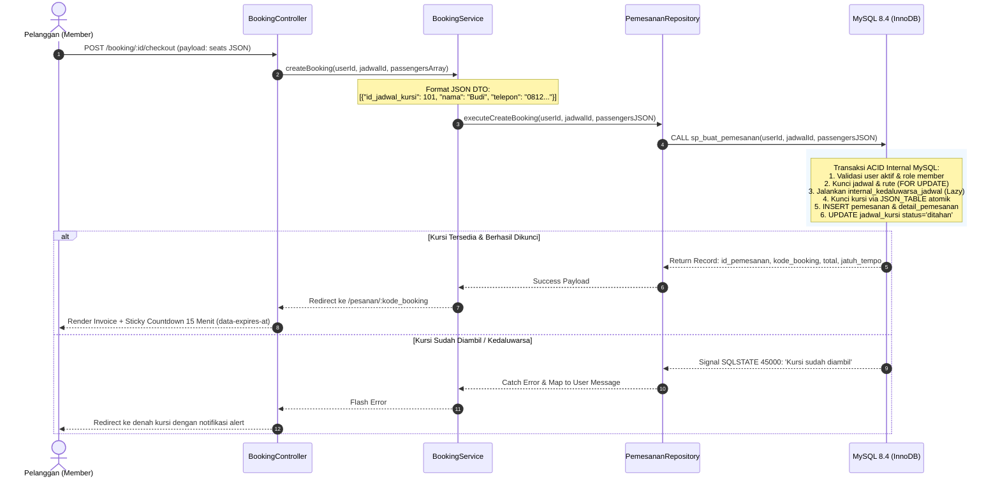
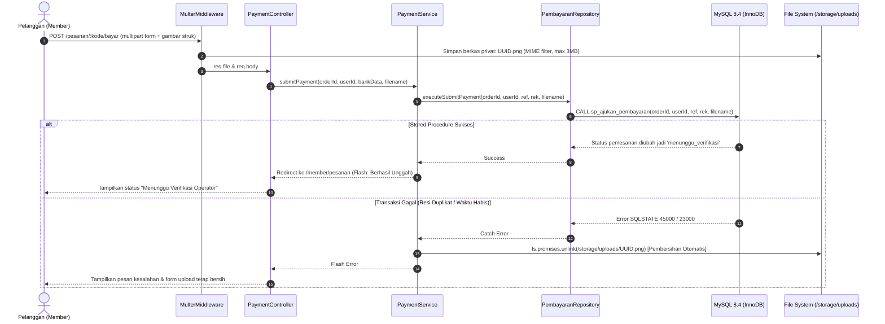
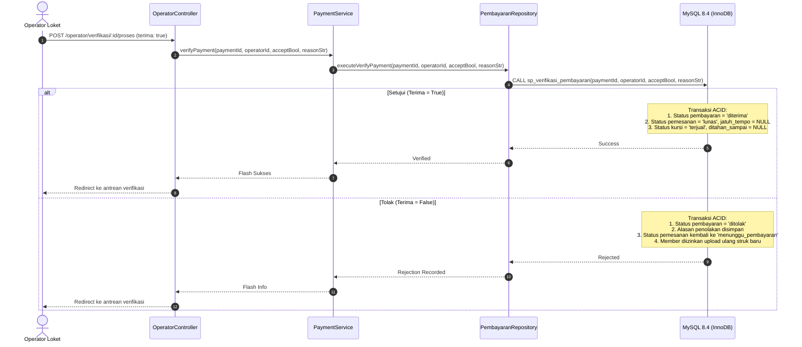
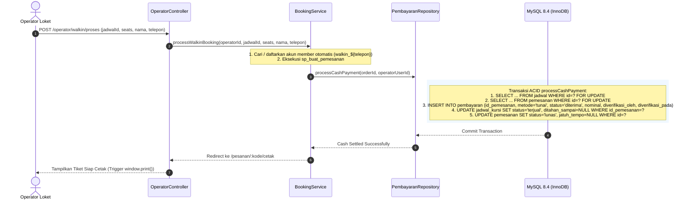

# Sistem Pemesanan Tiket Travel (Node.js + Tailwind CSS + MySQL 8.4 Docker)

* **Author:** Mahasiswa & Antigravity Pair
* **Status:** Approved
* **Date:** 2026-10-30

---

## Overview

Sistem Pemesanan Tiket Travel adalah aplikasi web monolitik berbasis kontainer (Docker) yang melayani pemesanan tiket travel antarkota untuk 3 peran: **Admin**, **Operator Loket**, dan **Member/Pelanggan**. Sistem ini mengonsumsi skema ternormalisasi MySQL 8.4 InnoDB pada `db_tiket.sql` tanpa mengubah struktur tabel bisnis maupun data historis yang ada. Seluruh alur reservasi kursi dan pengajuan transfer manual diisolasi menggunakan *stored procedures* transaksi ACID bawaan database, sedangkan transaksi pelunasan tunai loket diisolasi dalam transaksi terkontrol di repository layer sesuai urutan penguncian resmi database. Antarmuka aplikasi dibangun menggunakan server-side rendering (Express + EJS) dengan styling **Tailwind CSS** yang memenuhi standar aksesibilitas **WCAG 2.1 Level AA & AAA** dan sistem tema ganda (*Nordic Slate & Ocean Blue*).

---

## Problem Statement

Sistem pemesanan travel antarkota menghadapi tantangan operasional dan teknis yang signifikan:
1. **Risiko Double-Booking pada Kapasitas Terbatas**: Armada mobil travel minibus memiliki 5 kursi per perjalanan. Tanpa mekanisme penguncian atomik saat pemesanan bersamaan, kursi yang sama rawan terjual ganda.
2. **Keterikatan Skema Database Legacy Ternormalisasi**: Database `db_tiket.sql` memberlakukan *stored procedures*, *triggers*, dan *CHECK constraints* ketat (misal: kolom `ditahan_sampai` pada `jadwal_kursi` harus `NULL` saat kursi berstatus `terjual` atau `tersedia`). Penulisan transaksi ad-hoc manual di layer aplikasi berisiko memicu *deadlock* dan pelanggaran integritas kunci asing sirkular (`fk_alokasi_detail`).
3. **Akun Bawaan Belum Memiliki Kata Sandi (*Cold Start*)**: Seluruh akun pengguna hasil migrasi pada `db_tiket.sql` memiliki `password_hash = NULL` dan `wajib_reset_password = 1`. Sistem membutuhkan mekanisme aktivasi awal yang aman dari pembajakan akun (*account takeover*) berbasis verifikasi identitas (pencocokan username dan nomor telepon atau email terdaftar), tanpa bergantung pada gateway SMS/OTP eksternal.
4. **Verifikasi Pembayaran Manual & Proteksi Kursi Ditahan**: Sistem mengandalkan transfer bank manual dan pembayaran tunai loket. Tanpa alur verifikasi berkas struk yang aman dan pelepasan kursi kedaluwarsa yang tepat waktu, pesanan berisiko kedaluwarsa padahal pelanggan telah membayar, atau kursi tertahan tanpa batas waktu.

---

## Goals

* **Kepatuhan Fungsional Use Case**: Mengimplementasikan 11 use case diagram untuk Admin, Operator Loket, dan Member dalam 19 template antarmuka terstruktur.
* **Integritas Konkurensi & Transaksi ACID**: Menghubungkan proses reservasi kursi online langsung ke *stored procedures* resmi:
  * `sp_buat_pemesanan` (validasi kursi atomik via `JSON_TABLE`)
  * `sp_ajukan_pembayaran` (penguncian berkas bukti transfer)
  * `sp_verifikasi_pembayaran` (persetujuan/penolakan oleh operator)
  * `sp_kedaluwarsa_jadwal` (pelepasan kursi kedaluwarsa secara terjadwal/lazy)
  * `sp_batalkan_pemesanan` (pembatalan manual)
* **Penanganan Transaksi Loket Fisik (Walk-in)**: Operator dapat memproses penumpang walk-in dengan pembuatan akun member otomatis (*on-the-fly provisioning*) berbasis nomor telepon, pencatatan transaksi tunai ACID di repository, dan penerbitan tiket fisik instan via antarmuka cetak browser (`@media print`).
* **Antarmuka Aksesibel & Responsif**: Desain antarmuka Tailwind CSS memenuhi rasio kontras WCAG 2.1 AA/AAA (rasio kontras teks >= 4.5:1 untuk teks normal, >= 7:1 untuk teks utama), indikator status berbasis ikon dan teks ramah buta warna, navigasi keyboard penuh, serta tema ganda (*Nordic Slate & Ocean Blue*).
* **Penyimpanan Berkas Privat & Aman**: Bukti transfer disimpan di luar direktori web publik (`./storage/uploads`) dan hanya dapat diakses melalui endpoint berotentikasi operator.
* **Portabilitas Kontainer Penuh**: Orkestrasi terpadu via Docker Compose (`app` Node.js 22 LTS Alpine multi-stage dan `db` MySQL 8.4 resmi dengan volume persisten) yang dapat dijalankan dengan satu perintah.
* **Kesiapan Verifikasi Lingkungan Lokal**: Menyediakan skrip seeder kredensial akun bawaan (`seedPasswords.ts`) dan jadwal aktif hari ini/besok (`seedDemoSchedules.ts`) untuk verifikasi fungsional dan pengujian lokal.

---

## Non-Goals

* **Integrasi Payment Gateway Otomatis**: Tidak menggunakan pihak ketiga (Midtrans, Xendit, dsb.) karena tabel database dirancang untuk transfer manual (`referensi`, `no_rek_pengirim`, `bukti_pembayaran`) dan tunai loket.
* **Gateway SMS / WhatsApp Fisik**: Notifikasi status tiket disajikan melalui dashboard web dan banner peringatan tanpa integrasi gateway SMS/WhatsApp berbayar.
* **Pembangkitan Binary PDF Server-Side**: Tidak menggunakan headless browser berat (Puppeteer/Chromium) di server; pencetakan tiket dilakukan via browser native print stylesheet (`@media print`) dan `window.print()`.
* **Pelacakan Armada Berbasis GPS Real-Time**: Tidak mencakup pelacakan posisi kendaraan di peta interaktif.
* **Denah Kursi Dinamis > 5 Kursi**: Struktur armada terkunci pada kapasitas minibus 5 kursi sesuai data master `kursi_kendaraan`.

---

## Open Questions & Resolutions

* **Pertanyaan 1 (Strategi Akun Penumpang Walk-in)**: Bagaimana menangani constraint `role = 'member'` pada `sp_buat_pemesanan` untuk penumpang fisik di loket?  
  *Resolusi*: Formulir walk-in loket menerima Nama dan No Telepon penumpang. Backend mencari akun member aktif berdasarkan nomor telepon (`SELECT id FROM users WHERE telepon = ? AND role = 'member' LIMIT 1`). Jika belum ada, backend membuat akun baru secara otomatis:
  - `username`: `walkin_${telepon}` (jika terjadi benturan username unik, tambahkan 4 karakter acak).
  - `nama`: nama penumpang.
  - `telepon`: nomor telepon penumpang.
  - `role`: `'member'`.
  - `wajib_reset_password`: `1`.
  - `password_hash`: `NULL` (valid berdasarkan constraint `ck_users_password`).
* **Pertanyaan 2 (Penanganan Jadwal Historis 2017)**: Data jadwal bawaan bertanggal 2017, bagaimana menyediakan data jadwal aktif tanpa memicu error `SQLSTATE 45000`?  
  *Resolusi*: Prosedur `sp_buat_pemesanan` secara mutlak menolak pemesanan untuk jadwal dengan `berangkat_pada <= NOW()`. Oleh karena itu, pengujian tidak menampilkan jadwal kedaluwarsa 2017 pada katalog aktif, melainkan murni mengandalkan skrip CLI seeder `src/scripts/seedDemoSchedules.ts` untuk menyuntikkan jadwal aktif hari ini dan besok ke dalam database.

---

## Critical User Journeys (CUJs)

### CUJ 1: Member Melakukan Reservasi Kursi & Upload Bukti Pembayaran
* **Given**: Member telah login; jadwal rute travel aktif memiliki kursi berstatus `tersedia`.
* **When**: Member mencari rute, memilih Kursi 3 di denah kabin interaktif, mengisi identitas penumpang, menekan konfirmasi pemesanan, dan mengunggah foto struk transfer sebelum batas waktu 15 menit berakhir.
* **Then**: Prosedur `sp_buat_pemesanan` mengunci kursi (status: `ditahan`), kode booking `TKT-...` diterbitkan, dan `sp_ajukan_pembayaran` mengubah status pesanan menjadi `menunggu_verifikasi` sehingga terlindung dari pembatalan otomatis.

### CUJ 2: Operator Loket Memverifikasi Pembayaran & Menerbitkan Tiket Lunas
* **Given**: Terdapat pesanan berstatus `menunggu_verifikasi` dengan berkas bukti struk transfer di `./storage/uploads/`.
* **When**: Operator loket membuka antrean verifikasi pembayaran, mengakses pratinjau struk terproteksi, mencocokkan nominal dan nomor resi, lalu menekan tombol "Setujui Pembayaran".
* **Then**: Prosedur `sp_verifikasi_pembayaran` mengubah status pembayaran menjadi `diterima`, status pemesanan menjadi `lunas`, dan status kursi menjadi `terjual` (dengan `ditahan_sampai = NULL`). E-Tiket dapat dicetak langsung via antarmuka cetak browser (`@media print`).

### CUJ 3: Pemesanan Tiket Walk-in oleh Petugas Loket (Pembayaran Tunai)
* **Given**: Penumpang datang ke loket travel; petugas loket login pada portal operator.
* **When**: Petugas membuka menu pemesanan walk-in, memilih jadwal dan kursi kosong, memasukkan nama dan nomor telepon penumpang, menerima uang tunai, dan menekan "Proses Tiket Walk-in".
* **Then**: Sistem memverifikasi/mendaftarkan akun member berbasis nomor telepon, mengeksekusi `sp_buat_pemesanan`, menjalankan transaksi pelunasan tunai ACID `processCashPayment` di `pembayaran.repository.ts` (mencatat `metode = 'tunai'`, status `diterima`, pesanan `lunas`, kursi `terjual`), dan mencetak tiket fisik loket via `window.print()`.

### CUJ 4: Pelepasan Kursi Otomatis Akibat Pembayaran Kedaluwarsa
* **Given**: Member memesan Kursi 4, status kursi menjadi `ditahan` dengan batas waktu 15 menit (`ditahan_sampai`).
* **When**: Member tidak menyelesaikan unggah bukti transfer hingga batas 15 menit terlampaui.
* **Then**: Saat ada pengguna lain yang memesan jadwal tersebut, `sp_buat_pemesanan` secara native dan lazy menjalankan `internal_kedaluwarsa_jadwal`. Selain itu, background worker interval 5 menit mengeksekusi `CALL sp_kedaluwarsa_jadwal(jadwal_id)` untuk jadwal yang memiliki pesanan tertunda lewat waktu, membebaskan kursi kembali ke status `tersedia`.

---

## Proposed Architecture

### 1. High-Level Component Architecture

Sistem mengadopsi pola **Modular Layered Architecture (MVC + Service + Repository + Stored Procedures)**:

```mermaid
flowchart TD
    subgraph Client ["Client Tier (Browser)"]
        UI["EJS Views + Tailwind CSS\n(Dual-Theme Nordic Slate & Ocean Blue)\nWCAG 2.1 AA/AAA Compliant"]
        JS["Client Scripts\n(Sticky Countdown, Seat Toggle, Image Zoom/Rotate, Print Trigger)"]
    end

    subgraph Server ["Application Server (Node.js 22 LTS Alpine / Express)"]
        Routes["Router Layer (src/routes/)\npublic, auth, member, operator, admin"]
        MW["Middleware Layer (src/middlewares/)\nSession Auth, RBAC Guard, Multer, CSRF, Error Handler"]
        Controllers["Controller Layer (src/controllers/)\nHTTP Extraction, Zod Validation, EJS Rendering, File Send"]
        Services["Service Layer (src/services/)\nDomain Logic, Error Mapping, Orphaned File Cleanup, Expiry Worker"]
        Repos["Repository Layer (src/repositories/)\nData Access Layer, Parameterized Queries, SP Calls, Cash ACID Tx"]
    end

    subgraph Storage ["Private Storage & Persistence Tier (Docker)"]
        MySQL[("MySQL 8.4 InnoDB (db_tiket.sql)\nACID Stored Procedures:\nsp_buat_pemesanan, sp_ajukan_pembayaran,\nsp_verifikasi_pembayaran, sp_kedaluwarsa_jadwal")]
        SessionTable[("sessions table (express-mysql-session)")]
        UploadVolume[("Persistent Private Storage (/app/storage/uploads)\nPayment Receipts (Protected RBAC)")]
    end

    UI -->|HTTP GET / POST / Multipart| Routes
    Routes --> MW
    MW --> Controllers
    Controllers --> Services
    Services --> Repos
    Repos -->|CALL sp_* & Parameterized SQL| MySQL
    MW -->|Session Read / Write| SessionTable
    MW -->|Write receipt image| UploadVolume
    Controllers -->|res.sendFile (Protected)| UploadVolume
    Services -.->|Unlink on SQL failure| UploadVolume
```

---

### 2. Alur Data & Sequence Diagram Transaksi Kritis

#### A. Alur Reservasi Kursi & Checkout (Anti Double-Booking)


#### B. Alur Unggah Bukti Transfer & Pembersihan Berkas Yatim (Orphaned File Cleanup)


#### C. Alur Verifikasi Pembayaran oleh Operator Loket


#### D. Alur Transaksi Pembayaran Tunai Loket (Walk-in)


---

### 3. Integrasi Skema Database & Isolasi Repository

Seluruh repository di `src/repositories/` dirancang dengan pemisahan tanggung jawab (*Separation of Concerns*):

* **`pemesanan.repository.ts`**:
  * `createBooking(userId, jadwalId, passengersJSON)` ➔ `CALL sp_buat_pemesanan(?, ?, ?)`
  * `cancelBooking(orderId, userId, reason)` ➔ `CALL sp_batalkan_pemesanan(?, ?, ?)`
  * `getBookingByCode(bookingCode)` ➔ `SELECT p.*, j.berangkat_pada, r.asal, r.tujuan FROM pemesanan p JOIN jadwal j ON j.id=p.id_jadwal JOIN rute r ON r.id=j.id_rute WHERE p.kode_booking = ?`
  * `getMemberBookings(userId)` ➔ `SELECT * FROM pemesanan WHERE id_pemesan = ? ORDER BY dibuat_pada DESC`
* **`pembayaran.repository.ts`**:
  * `submitPaymentProof(orderId, userId, ref, acc, filename)` ➔ `CALL sp_ajukan_pembayaran(?, ?, ?, ?, ?)`
  * `verifyPayment(paymentId, operatorId, isApproved, rejectReason)` ➔ `CALL sp_verifikasi_pembayaran(?, ?, ?, ?)`
  * `processCashPayment(orderId, operatorUserId)` ➔ Transaksi ACID manual (urutan lock strict: jadwal -> pemesanan -> pembayaran & kursi) mencatat `metode = 'tunai'`, status `diterima`, pemesanan `lunas`, kursi `terjual`.
  * `getPendingPayments()` ➔ `SELECT p.*, o.kode_booking, o.total_tagihan, u.nama as nama_pemesan FROM pembayaran p JOIN pemesanan o ON o.id=p.id_pemesanan JOIN users u ON u.id=o.id_pemesan WHERE p.status = 'menunggu'`
  * `getPaymentById(paymentId)` ➔ `SELECT * FROM pembayaran WHERE id = ?`
* **`jadwal.repository.ts`**:
  * `getActiveSchedules(originCityId, destCityId, dateStr)` ➔ `SELECT j.*, r.id_kota_asal, r.id_kota_tujuan, k.nama as nama_kendaraan, k.nomor_polisi FROM jadwal j JOIN rute r ON r.id=j.id_rute JOIN kendaraan k ON k.id=j.id_kendaraan WHERE j.status = 'dijadwalkan' AND j.berangkat_pada > NOW() ...`
  * `getScheduleSeats(jadwalId)` ➔ `SELECT s.id, s.id_kursi, k.nomor, k.urutan, s.status, s.ditahan_sampai FROM jadwal_kursi s JOIN kursi_kendaraan k ON k.id=s.id_kursi WHERE s.id_jadwal = ? ORDER BY k.urutan`
  * `releaseExpiredHolds(jadwalId)` ➔ `CALL sp_kedaluwarsa_jadwal(?)`
  * `findSchedulesWithExpiredHolds()` ➔ `SELECT DISTINCT id_jadwal FROM pemesanan WHERE status = 'menunggu_pembayaran' AND jatuh_tempo <= NOW()`
  * `createSchedule(data)`, `updateSchedule(id, data)`, `deleteSchedule(id)` ➔ Operasi mutasi data master jadwal admin.
* **`user.repository.ts`**:
  * `findUserByUsernameOrEmail(identifier)` ➔ `SELECT * FROM users WHERE username = ? OR email = ?`
  * `findUserByPhone(phone)` ➔ `SELECT * FROM users WHERE telepon = ? AND role = 'member' LIMIT 1`
  * `verifyLegacyAccount(username, phoneOrEmail)` ➔ `SELECT id FROM users WHERE username = ? AND (telepon = ? OR email = ?) AND wajib_reset_password = 1 AND password_hash IS NULL`
  * `createMemberAccount(userData)` ➔ `INSERT INTO users (username, nama, telepon, role, password_hash, wajib_reset_password) ...`
  * `updatePasswordHash(userId, newHash)` ➔ `UPDATE users SET password_hash = ?, wajib_reset_password = 0 WHERE id = ?`
  * `getAllUsers(roleFilter)` ➔ Operasi monitoring akun pengguna oleh admin.
* **`rute.repository.ts`**:
  * `getAllCities()`, `createRoute(data)`, `updateRoute(id, data)`, `deleteRoute(id)` ➔ Operasi master rute dan kota.
* **`kendaraan.repository.ts`**:
  * `getAllVehicles()`, `createVehicle(data)`, `updateVehicle(id, data)` ➔ Operasi master armada minibus.
* **`keluhan.repository.ts`**:
  * `submitComplaint(userId, orderId, category, message)` ➔ `INSERT INTO keluhan ...`
  * `getComplaintsByMember(userId)` ➔ `SELECT * FROM keluhan WHERE id_pelapor = ?`
  * `getAllComplaints()` ➔ `SELECT k.*, u.nama as nama_pelapor FROM keluhan k JOIN users u ON u.id=k.id_pelapor ORDER BY k.dibuat_pada DESC`
  * `respondToComplaint(id, response, adminUserId, status)` ➔ `UPDATE keluhan SET tanggapan = ?, ditangani_oleh = ?, status = ?, selesai_pada = NOW() WHERE id = ?`

---

### 4. Topologi Kontainer Docker & Orkestrasi Deployment

File `docker-compose.yml` mengorkestrasi 2 service inti dengan isolasi jaringan dan volume persisten:
* **Service `db`**:
  * Image resmi `mysql:8.4`.
  * Konfigurasi inisialisasi: `./db_tiket.sql:/docker-entrypoint-initdb.d/init.sql:ro`.
  * Persistent volume `db_data:/var/lib/mysql`.
  * Port mapping `3306:3306` untuk mendukung pengujian integrasi lokal.
  * `healthcheck`: Pengujian `mysqladmin ping -h localhost` setiap 5 detik.
* **Service `app`**:
  * Build dari `Dockerfile` (Node.js 22 LTS Alpine multi-stage build).
  * Menunggu status `db` bernilai `service_healthy` sebelum mengeksekusi `node dist/server.js`.
  * Persistent volume `./storage/uploads:/app/storage/uploads` di luar web root statis Express untuk menjamin keamanan dan persistensi berkas struk.
  * Port `3000:3000`.

---

## Alternatives Considered

### Alternative A: Monolith Framework PHP (Laravel 11 + Blade)
* **Deskripsi Pendekatan**: Membangun aplikasi menggunakan PHP 8.3 dengan framework Laravel 11, memanfaatkan Eloquent ORM dan Blade template.
* **Kelebihan (Pros)**:
  * Fitur bawaan lengkap (CSRF, multi-auth guards, Blade components).
* **Kekurangan & Alasan Penolakan (Cons & Why Rejected)**:
  * *Resource Footprint Tinggi*: Image Docker (PHP-FPM + Nginx + Composer) berukuran ~250MB dengan konsumsi RAM idle ~180–250MB (dibandingkan Node.js Alpine ~75MB image, ~50MB RAM).
  * *Friksi Konvensi Skema*: Laravel mengasumsikan kolom `password` (bukan `password_hash`) dan nama tabel jamak bahasa Inggris. Skema `db_tiket.sql` menggunakan penamaan Indonesia (`id_pemesan`, `bukti_pembayaran`, `password_hash`, `wajib_reset_password`) yang menuntut penulisan override manual pada model Eloquent dan custom `UserProvider`.

---

### Alternative B: Decoupled REST API + React/Vue SPA Frontend
* **Deskripsi Pendekatan**: Memisahkan backend murni Express REST API (JSON) dan frontend Single Page Application (SPA) berbasis React/Vite.
* **Kelebihan (Pros)**:
  * Pemisahan independen antara logika API dan UI klien.
* **Kekurangan & Alasan Penolakan (Cons & Why Rejected)**:
  * *Overhead Integrasi Lintas-Layanan*: Mengharuskan orkestrasi 2 kontainer web server terpisah, konfigurasi CORS, sinkronisasi cookie sesi lintas port, dan state management rumit. Monolith SSR (EJS + Tailwind) jauh lebih cepat dibangun dan bebas isu CORS.

---

### Alternative C: Manual Two-Phase Seat Locking di Layer Aplikasi (TypeScript)
* **Deskripsi Pendekatan**: Mengabaikan stored procedure database dan mengeksekusi penguncian kursi via rangkaian kueri manual di Node.js (`START TRANSACTION` -> `SELECT FOR UPDATE` -> `INSERT detail` -> `UPDATE kursi`).
* **Kelebihan (Pros)**:
  * Seluruh logika transaksi berada di dalam kode sumber TypeScript.
* **Kekurangan & Alasan Penolakan (Cons & Why Rejected)**:
  * *Risiko Deadlock & Constraint Violation*: Skema `db_tiket.sql` memiliki relasi foreign key sirkular `fk_alokasi_detail` dan urutan penguncian ketat (`jadwal -> pemesanan -> pembayaran / jadwal_kursi`). Transaksi manual di Node.js rawan memicu deadlock dan redundansi logika transaksional yang sudah teruji aman di database.

---

### Alternative D: Server-Side PDF Engine (Puppeteer/PDFKit) vs Browser-Native Print (@media print)
* **Deskripsi Pendekatan**: Menghasilkan berkas biner PDF di server menggunakan headless browser Puppeteer/Chromium atau pustaka kanvas biner `pdfkit` untuk cetak tiket.
* **Kelebihan (Pros)**:
  * Menghasilkan file PDF statis yang dapat diunduh langsung sebagai lampiran biner.
* **Kekurangan & Alasan Penolakan (Cons & Why Rejected)**:
  * *Pembengkakan Kontainer & Risiko OOM*: Puppeteer membutuhkan biner Chromium yang melipatgandakan ukuran Docker image (>500MB) dan konsumsi memori RAM server (>300MB), melanggar kriteria efisiensi sumber daya. Pustaka `pdfkit` menuntut ratusan baris koordinat layout biner yang kaku.
  * *Solusi Terpilih*: Mengadopsi **Browser-Native Printing (`@media print`)** pada rute `/pesanan/:kode/cetak` dengan pemicu `window.print()`. Pendekatan ini memiliki nol dependensi tambahan, nol beban CPU/RAM server, dan mendukung printer thermal loket 80mm maupun kertas A4 secara native.

---

### Tabel Komparasi Alternatif Arsitektur

| Dimensi Evaluasi | Pilihan Terpilih: Node.js SSR Monolith (EJS) | Alternative A: Laravel 11 | Alternative B: Express + React SPA | Alternative D: Server-Side PDF Engine |
| :--- | :--- | :--- | :--- | :--- |
| **Ukuran Image Docker** | Ringan (~75MB Alpine) | Berat (~250MB FPM+Nginx) | Sedang (~180MB 2 kontainer) | Sangat Berat (>500MB + Chromium) |
| **Konsumsi RAM Idle** | ~45–65 MB | ~180–250 MB | ~120–160 MB | >300 MB saat render |
| **Kesesuaian Skema Legacy** | 100% Cocok (Parameter murni) | Rendah (Banyak override) | 100% Cocok | N/A (Khusus output tiket) |
| **Kompleksitas Deployment** | 1 File Compose, 2 Services | Butuh PHP-FPM + Nginx | Butuh Web Server SPA + API | Butuh dependensi font C++ & browser |
| **Kecepatan Cetak Tiket** | Instan (Browser `@media print`) | Sama | Sama | Lambat (Startup headless browser) |

---

## Risks & Mitigations

| Risiko & Potensi Kegagalan | Tingkat Dampak | Skenario Pemicu | Strategi Mitigasi Arsitektural |
| :--- | :--- | :--- | :--- |
| **Kontensi Lock & Deadlock Transaksi Konkuren** | Tinggi | Beberapa pelanggan memesan kursi pada jadwal yang sama secara bersamaan. | Mengisolasi alur pemesanan ke `sp_buat_pemesanan` yang menerapkan urutan lock teratur (`jadwal FOR UPDATE` ➔ evaluasi atomik `JSON_TABLE`). Menetapkan `queueLimit: 100` pada pool `mysql2` untuk backpressure. |
| **Kebocoran Informasi Sensitif Bukti Transfer** | Tinggi | Pengguna tidak berhak mengakses URL bukti struk perbankan pelanggan lain. | Menyimpan berkas di folder privat `./storage/uploads/` (di luar root web publik Express). Melayani pratinjau hanya melalui endpoint `GET /operator/pembayaran/:id/bukti` yang dilindungi role operator. |
| **Penumpukan Berkas Unggahan Yatim (*Orphaned Files*)** | Sedang | Pengguna mengunggah gambar struk, namun transaksi database gagal (misal nomor resi duplikat). | `payment.service.ts` membungkus pemanggilan repository dalam blok `try...catch`. Jika database melempar error, berkas fisik langsung dihapus dari disk via `fs.promises.unlink()`. |
| **Pembajakan Akun Warisan (*Account Takeover*)** | Tinggi | Pihak tidak berwenang mencoba mereset password akun legacy (`wajib_reset_password = 1`). | Form aktivasi `/auth/activate` memvalidasi `username` dan mencocokkan nomor telepon atau email terdaftar di database sebelum mengizinkan pembuatan password baru. |
| **Kontensi Lock oleh Background Expiry Worker** | Sedang | Worker menjalankan `sp_kedaluwarsa_jadwal` pada seluruh jadwal secara konstan. | Memanfaatkan pembersihan *lazy* bawaan `sp_buat_pemesanan`, serta membatasi worker interval 5 menit hanya pada jadwal dengan pesanan tertunda lewat batas bayar via `findSchedulesWithExpiredHolds()`. |

---

## Non-Functional Requirements

### 1. Keamanan & Proteksi Data (Security)
* **Session Security**: Cookie sesi bertandatangan kriptografis dengan flag `httpOnly: true`, `sameSite: 'lax'`, dan disimpan secara persisten di database MySQL via `express-mysql-session` dengan opsi `createDatabaseTable: true`.
* **RBAC Enforcement**: Middleware otentikasi memeriksa hak akses pengguna pada setiap rute:
  * `/admin/*` ➔ Dibatasi hanya untuk `role = 'admin'`.
  * `/operator/*` ➔ Dibatasi untuk `role = 'operator'` dan `admin`.
  * `/member/*` ➔ Dibatasi untuk `role = 'member'`, disertai validasi kepemilikan data (member hanya dapat melihat pesanan miliknya sendiri).
  * Pengguna dengan `wajib_reset_password = 1` otomatis dialihkan ke `/auth/activate` kecuali pada rute publik dan logout.
* **Sanitasi Unggahan Bukti Transfer**:
  * Pengecekan ekstensi dan MIME type berkas (hanya menerima `image/jpeg`, `image/png`, `image/webp`).
  * Batas ukuran berkas maksimal 3MB.
  * Nama berkas diganti dengan pengidentifikasi unik acak UUID v4 (`crypto.randomUUID()`) untuk mencegah serangan *path traversal*.
* **Proteksi CSRF**: Menerapkan token proteksi CSRF (menggunakan pustaka `csrf-csrf`) pada seluruh formulir transaksi HTML POST (`/booking/:id/checkout`, `/pesanan/:kode/bayar`, `/operator/verifikasi/:id/proses`, `/operator/walkin/proses`).

### 2. Kinerja & Efisiensi Sumber Daya (Performance)
* **Runtime Footprint Rendah**: Kontainer Node.js 22 LTS berbasis Alpine Linux beroperasi dengan konsumsi memori idle ~45–65MB RAM.
* **Database Connection Pooling**: Menggunakan pool koneksi `mysql2/promise` dengan konfigurasi `connectionLimit: 15`, `waitForConnections: true`, `queueLimit: 100`, dan timeout akuisisi 10 detik untuk mencegah penumpukan request tanpa batas di RAM.
* **BigInt & Decimal Safe**: Driver dikonfigurasi dengan `supportBigNumbers: true` dan `bigNumberStrings: true` untuk menjamin integritas nilai mata uang rupiah dan primary key `BIGINT UNSIGNED`.

### 3. Ketersediaan & Pemulihan (Resilience & Rollback)
* **Kesiapan Kontainer (Container Readiness)**: Kontainer aplikasi menunggu sinyal *healthy* dari MySQL (`mysqladmin ping`) sebelum melakukan binding port HTTP.
* **Persistensi Data**: Seluruh data transaksi tersimpan di Docker named volume `db_data`, dan seluruh berkas struk pembayaran tersimpan di volume lokal `./storage/uploads`.
* **Prosedur Rollback**: Jika terjadi kegagalan sistem, aplikasi dapat di-rollback tanpa kehilangan data dengan menjalankan `docker compose down` dan memulihkan snapshot database via file dump yang tersedia.

---

## Detailed Implementation Plan

Implementasi dibagi menjadi **6 Fase Inkremental** yang terstruktur secara sekuensial. Setiap fase meninggalkan basis kode dalam kondisi stabil dan dapat diverifikasi:

### Phase 1: Environment, Manifests, & Docker Baseline
*Tujuan*: Membangun fondasi proyek, konfigurasi compiler, styling, dan kontainerisasi.
* **`package.json`** (Create)
  * *Dependencies*: `express`, `mysql2`, `express-session`, `express-mysql-session`, `multer`, `bcryptjs`, `zod`, `ejs`, `dotenv`, `csrf-csrf`, `connect-flash`.
  * *DevDependencies*: `typescript`, `@types/node`, `@types/express`, `@types/multer`, `@types/bcryptjs`, `@types/express-session`, `@types/connect-flash`, `@types/ejs`, `tailwindcss`, `tsx`, `vitest`.
  * *Scripts*: 
    * `"dev"`: `"tsx watch src/server.ts"`,
    * `"build"`: `"tsc && npx tailwindcss -i ./public/css/input.css -o ./public/css/output.css --minify"`,
    * `"typecheck"`: `"tsc --noEmit"`,
    * `"start"`: `"node dist/server.js"`,
    * `"seed:passwords"`: `"tsx src/scripts/seedPasswords.ts"`,
    * `"seed:demo-schedules"`: `"tsx src/scripts/seedDemoSchedules.ts"`,
    * `"test"`: `"vitest run"`.
* **`tsconfig.json`** (Create): Target `ES2022`, module resolution `NodeNext`, `strict: true`, rootDir `src/`, outDir `dist/`.
* **`tailwind.config.js`** (Create): Mode gelap berbasis class (`darkMode: 'class'`), palet warna Nordic Slate (`slate-950` / `slate-50`) & Ocean Blue.
* **`Dockerfile`** (Create): Multi-stage build (Stage 1 builder mengompilasi TS dan Tailwind; Stage 2 runner berbasis Alpine menyalin `dist/`, `views/`, dan `public/`).
* **`docker-compose.yml`** (Create): Service `db` (MySQL 8.4 port 3306, inisialisasi `db_tiket.sql`, healthcheck) dan service `app` (Node.js port 3000, volume `./storage/uploads`).
* **`.env.example`** & **`.gitignore`** (Create): Konfigurasi database, session secret, dan pengabaian `node_modules`, `dist`, `.env`.
* *Exit Criteria*: Proyek lolos `npm run typecheck`, dan `docker compose up --build -d` berhasil menginisialisasi MySQL dengan status healthy.

---

### Phase 2: Database Schema Types, Connection Pool, & DAL (Repositories)
*Tujuan*: Menyediakan lapisan tipe data lengkap dan akses database terisolasi.
* **`src/types/db.types.ts`** (Create): Interface TypeScript untuk seluruh 12 tabel (`users`, `kota`, `kendaraan`, `kursi_kendaraan`, `rute`, `jadwal`, `jadwal_kursi`, `pemesanan`, `detail_pemesanan`, `pembayaran`, `keluhan`, `arsip_migrasi`) dan tipe record hasil stored procedures.
* **`src/types/booking.types.ts`** (Create): Interface DTO penumpang `[{"id_jadwal_kursi": number, "nama": string, "telepon": string}]`, schema Zod untuk checkout, dan kriteria filter jadwal.
* **`src/config/database.ts`** (Create): Inisialisasi pool `mysql2/promise` dengan `connectionLimit: 15`, `queueLimit: 100`, dan `bigNumberStrings: true`.
* **`src/repositories/`** (Create):
  * `pemesanan.repository.ts`: Pemanggilan `sp_buat_pemesanan`, `sp_batalkan_pemesanan`, kueri riwayat pesanan.
  * `pembayaran.repository.ts`: Pemanggilan `sp_ajukan_pembayaran`, `sp_verifikasi_pembayaran`, kueri pembayaran pending, dan metode `processCashPayment` (transaksi ACID pelunasan tunai).
  * `jadwal.repository.ts`: Kueri jadwal aktif, denah kursi, kueri `findSchedulesWithExpiredHolds`, `releaseExpiredHolds`, dan CRUD jadwal admin.
  * `user.repository.ts`: Kueri pencarian user by username/telepon, verifikasi akun legacy, pendaftaran member, update password hash, dan list user.
  * `rute.repository.ts` & `kendaraan.repository.ts`: Kueri dan mutasi master kota/rute dan armada kendaraan.
  * `keluhan.repository.ts`: Pengajuan keluhan, kueri daftar keluhan member/admin, dan metode `respondToComplaint`.
* *Exit Criteria*: Kompilasi DAL berhasil tanpa error tipe, pool database terhubung sukses ke MySQL.

---

### Phase 3: Security, Session, & Authentication Middleware
*Tujuan*: Membangun sistem sesi, otorisasi peran, sanitasi berkas privat, dan proteksi CSRF.
* **`src/types/express.d.ts`** (Create): Augmentasi interface `SessionData` dengan `user: { id: number; username: string; nama: string; role: 'admin'|'operator'|'member'; wajib_reset_password: number }`.
* **`src/config/session.ts`** (Create): Konfigurasi `express-mysql-session` dengan opsi `createDatabaseTable: true` dan cookie `httpOnly`, `sameSite: 'lax'`.
* **`src/middlewares/auth.middleware.ts`** (Create): Memvalidasi sesi aktif, mengalihkan pengguna `wajib_reset_password = 1` ke `/auth/activate` (dengan whitelist rute `/auth/activate`, `/logout`, `/login`).
* **`src/middlewares/role.middleware.ts`** (Create): Otorisasi peran (`roleGuard(['admin'])`, `roleGuard(['operator', 'admin'])`, `roleGuard(['member'])`).
* **`src/middlewares/upload.middleware.ts`** (Create): Multer storage ke `./storage/uploads/` dengan nama berkas acak UUID v4 dan validasi tipe berkas gambar.
* **`src/middlewares/csrf.middleware.ts`** (Create): Konfigurasi token CSRF via `csrf-csrf` dan injeksi token ke `res.locals.csrfToken`.
* **`src/middlewares/error.middleware.ts`** (Create): Penanganan error terpusat, pemetaan pesan `SQLSTATE 45000` dan `SQLSTATE 23000` ke flash alert, dan penanganan HTTP 404/500.
* *Exit Criteria*: Pengujian rute guard menolak akses tanpa otorisasi dan token CSRF terpasang pada sesi.

---

### Phase 4: Core Domain Services & Background Worker
*Tujuan*: Mengorkestrasi logika bisnis transaksi, mitigasi file yatim, dan pembersihan kursi otomatis.
* **`src/services/auth.service.ts`** (Create): Logika autentikasi login, hash Bcrypt, aktivasi akun legacy berbasis username + telepon/email, dan pendaftaran member baru.
* **`src/services/booking.service.ts`** (Create): Validasi skema Zod payload pemesanan, pemanggilan prosedur reservasi, dan logika otomatisasi pembuatan member walk-in (`walkin_${telepon}`).
* **`src/services/payment.service.ts`** (Create): Logika unggah bukti transfer, pembersihan berkas fisik (`fs.promises.unlink`) jika stored procedure gagal, verifikasi pembayaran oleh operator, dan eksekusi `processCashPayment`.
* **`src/services/admin.service.ts`** (Create): Layanan agregasi statistik pemesanan, pendapatan, dan CRUD data master.
* **`src/services/expiry.worker.ts`** (Create): Background worker interval 5 menit yang mencari jadwal dengan pesanan tertunda lewat waktu (`findSchedulesWithExpiredHolds`) dan memanggil `sp_kedaluwarsa_jadwal`.
* *Exit Criteria*: Pengujian unit service layer lulus untuk kalkulasi tarif, validasi form, dan alur pembersihan berkas yatim.

---

### Phase 5: Presentation Layer (Web Controllers, Routing Table, & EJS Views)
*Tujuan*: Menyediakan seluruh endpoint HTTP dan 19 antarmuka visual responsif Tailwind CSS.

#### Tabel Routing HTTP Sistem

| Method | URL Path | Handler Controller | Middleware Guard | Deskripsi & View Terkait |
| :--- | :--- | :--- | :--- | :--- |
| `GET` | `/` | `publicController.home` | - | Beranda & pencarian rute (`home.ejs`) |
| `GET` | `/jadwal` | `publicController.searchSchedules` | - | Katalog hasil pencarian jadwal (`jadwal-list.ejs`) |
| `GET` | `/login` | `authController.showLogin` | Guest only | Formulir login (`login.ejs`) |
| `POST` | `/login` | `authController.processLogin` | CSRF | Proses autentikasi pengguna |
| `GET` | `/register` | `authController.showRegister` | Guest only | Formulir pendaftaran member (`register.ejs`) |
| `POST` | `/register` | `authController.processRegister` | CSRF | Proses pendaftaran akun member |
| `GET` | `/auth/activate` | `authController.showActivate` | - | Formulir aktivasi kata sandi legacy (`activate.ejs`) |
| `POST` | `/auth/activate` | `authController.processActivate` | CSRF | Verifikasi identitas & update password |
| `POST` | `/logout` | `authController.logout` | Auth | Hapus sesi pengguna |
| `GET` | `/booking/:id/kursi` | `memberController.showSeatSelection`| Member | Denah pemilihan kursi minibus (`seat-selection.ejs`) |
| `POST` | `/booking/:id/checkout`| `memberController.processCheckout` | Member, CSRF | Reservasi kursi via `sp_buat_pemesanan` |
| `GET` | `/pesanan/:kode` | `memberController.showInvoice` | Member/Owner | Halaman invoice & countdown 15m (`invoice.ejs`) |
| `GET` | `/pesanan/:kode/bayar` | `memberController.showPaymentForm`| Member/Owner | Form unggah bukti transfer (`payment-form.ejs`) |
| `POST` | `/pesanan/:kode/bayar` | `memberController.submitPayment` | Member, Upload, CSRF | Eksekusi `sp_ajukan_pembayaran` |
| `POST` | `/pesanan/:kode/batal` | `memberController.cancelOrder` | Member, CSRF | Pembatalan pesanan via `sp_batalkan_pemesanan` |
| `GET` | `/pesanan/:kode/cetak` | `memberController.printTicket` | Member/Owner/Op | Tampilan cetak tiket browser (`@media print`) |
| `GET` | `/member/pesanan` | `memberController.myTickets` | Member | Riwayat tiket perjalanan (`my-tickets.ejs`) |
| `GET` | `/member/keluhan` | `memberController.showComplaints` | Member | Daftar & form pengajuan keluhan (`complaints.ejs`) |
| `POST` | `/member/keluhan` | `memberController.submitComplaint`| Member, CSRF | Kirim keluhan baru |
| `GET` | `/operator/dashboard` | `operatorController.dashboard` | Operator | Statistik loket & antrean (`dashboard.ejs`) |
| `GET` | `/operator/verifikasi` | `operatorController.verificationQueue`| Operator | Daftar pembayaran tertunda (`verifikasi.ejs`) |
| `GET` | `/operator/verifikasi/:id` | `operatorController.verificationDetail`| Operator | Review struk pembayaran (`verifikasi-detail.ejs`) |
| `GET` | `/operator/pembayaran/:id/bukti` | `operatorController.streamReceipt`| Operator | Layani berkas struk privat terproteksi |
| `POST` | `/operator/verifikasi/:id/proses`| `operatorController.processVerification`| Operator, CSRF | Eksekusi `sp_verifikasi_pembayaran` |
| `GET` | `/operator/walkin` | `operatorController.showWalkinOrder` | Operator | Form transaksi tiket loket (`walkin-order.ejs`) |
| `POST` | `/operator/walkin/proses`| `operatorController.processWalkinOrder`| Operator, CSRF | Buat member + reservasi + pelunasan tunai |
| `GET` | `/operator/orders` | `operatorController.orderList` | Operator | Daftar seluruh pesanan loket (`orders.ejs`) |
| `GET` | `/admin/dashboard` | `adminController.dashboard` | Admin | Statistik pendapatan & armada (`dashboard.ejs`) |
| `GET` | `/admin/master` | `adminController.masterData` | Admin | Kelola kota, rute, armada, jadwal (`master-data.ejs`) |
| `POST` | `/admin/master/:entity` | `adminController.mutateMaster` | Admin, CSRF | Tambah/ubah/hapus data master |
| `GET` | `/admin/users-keluhan` | `adminController.usersAndComplaints`| Admin | Monitoring pengguna & keluhan (`users-complaints.ejs`) |
| `POST` | `/admin/keluhan/:id/tanggapi`| `adminController.respondComplaint`| Admin, CSRF | Kirim tanggapan & selesaikan keluhan |

* **Struktur Template Tampilan (`views/`)**:
  * `views/layouts/` (`main.ejs`, `dashboard.ejs`).
  * `views/partials/` (`navbar.ejs`, `footer.ejs`, `flash.ejs`, `seat-layout.ejs`).
  * `views/public/` (5 template: `home`, `jadwal-list`, `login`, `register`, `activate`).
  * `views/member/` (6 template: `seat-selection`, `checkout`, `invoice`, `payment-form`, `my-tickets`, `complaints`).
  * `views/operator/` (5 template: `dashboard`, `verifikasi`, `verifikasi-detail`, `orders`, `walkin-order`).
  * `views/admin/` (3 template: `dashboard`, `master-data`, `users-complaints`).
* **Aset Skrip Klien (`public/js/`)**:
  * `countdown.js`: Membaca atribut `data-expires-at` dan menghitung mundur secara real-time.
  * `seat-selection.js`: Interaktivitas pemilihan kursi minibus 5 penumpang dengan keyboard accessibility (`Tab`/`Space`).
  * `theme-toggle.js`: Pengalih tema Gelap/Terang tersimpan di `localStorage`.
  * `image-preview.js`: Utilitas zoom dan rotasi gambar bukti transfer bagi operator.
* *Exit Criteria*: Seluruh 19 halaman dapat dirender dengan layout Tailwind CSS yang rapi dan bebas dari error tampilan.

---

### Phase 6: Seeders, Accessibility Polish, & Integration Verification
*Tujuan*: Menyediakan data pengujian, memastikan kepatuhan aksesibilitas, dan menguji alur end-to-end.
* **`src/scripts/seedPasswords.ts`** (Create): Mengisi hash kata sandi Bcrypt (`Password123!`) untuk seluruh akun pengguna hasil migrasi pada `db_tiket.sql` untuk pengujian lokal.
* **`src/scripts/seedDemoSchedules.ts`** (Create): Menyuntikkan jadwal keberangkatan aktif tanggal hari ini dan besok beserta armada mobil aktif.
* **`src/server.ts`** (Create): Inisialisasi Express app, middleware mounting, pendaftaran rute, static serving publik, dan aktivasi background worker.
* **`tests/`** (Create): Pengujian unit service layer dan integrasi stored procedure via Vitest.
* *Exit Criteria*: Skrip seeder berhasil dieksekusi, seluruh pengujian unit/integrasi lulus, dan 4 CUJ terverifikasi penuh di browser.

---

## Verification Plan

Rencana pengujian untuk memvalidasi keberhasilan implementasi sistem:

1. **Compilation & Type Check**:
   * *Perintah*: `npm run typecheck` dilanjutkan `npm run build`.
   * *Kriteria Sukses*: Nol error kompilasi TypeScript (`strict: true`), berkas `dist/server.js` dan `public/css/output.css` terbit tanpa cacat.
2. **Container Orchestration Verification**:
   * *Perintah*: `docker compose up --build -d`.
   * *Kriteria Sukses*: Kedua kontainer (`app` dan `db`) berjalan dengan status `healthy`, port 3000 dapat diakses melalui browser.
3. **Unit & Integration Testing**:
   * *Perintah*: `npm test`.
   * *Kriteria Sukses*: Seluruh skenario pengujian unit service (validasi payload Zod, kalkulasi tarif, pembersihan berkas yatim) dan integrasi stored procedure lulus 100%.
4. **End-to-End User Journey Verification (4 CUJ Kritis)**:
   * *CUJ 1 (Reservasi & Upload Transfer)*:
     * *Aksi*: Member login ➔ Pilih Kursi 2 ➔ Submit checkout ➔ Muncul invoice dengan countdown timer 15 menit ➔ Upload foto bukti transfer.
     * *Kriteria Sukses*: Kursi berubah menjadi `ditahan` di database, berkas tersimpan di `./storage/uploads/`, dan status pesanan menjadi `menunggu_verifikasi`.
   * *CUJ 2 (Verifikasi Operator & Cetak Tiket)*:
     * *Aksi*: Operator login ➔ Buka antrean verifikasi ➔ Review gambar struk ➔ Tekan tombol "Setujui Pembayaran" ➔ Buka halaman tiket ➔ Tekan cetak.
     * *Kriteria Sukses*: Status pembayaran menjadi `diterima`, pemesanan menjadi `lunas`, kursi menjadi `terjual` (`ditahan_sampai = NULL`), dan antarmuka cetak `@media print` muncul sempurna.
   * *CUJ 3 (Transaksi Walk-in Loket)*:
     * *Aksi*: Operator membuka form walk-in ➔ Input nama dan nomor HP ➔ Pilih Kursi 1 ➔ Submit pembayaran tunai.
     * *Kriteria Sukses*: Akun member baru otomatis terdaftar di tabel `users`, transaksi tunai ACID selesai, status pemesanan langsung `lunas`, dan tiket siap cetak.
   * *CUJ 4 (Timeout & Pelepasan Kursi)*:
     * *Aksi*: Buat reservasi kursi tanpa upload bukti bayar hingga lewat 15 menit ➔ Coba lakukan pemesanan baru pada kursi tersebut oleh pengguna lain.
     * *Kriteria Sukses*: Pembersihan lazy native `sp_buat_pemesanan` otomatis membebaskan kursi kedaluwarsa dan mengizinkan pemesanan baru.
5. **Aksesibilitas & UI Check**:
   * *Pengujian*: Audit browser devtools Lighthouse pada halaman utama, katalog, dan form pemesanan.
   * *Kriteria Sukses*: Lighthouse Accessibility Score >= 90, rasio kontras teks memenuhi standar WCAG AA (minimal 4.5:1), denah kursi dapat dioperasikan penuh menggunakan tombol `Tab` dan `Space`, serta perpindahan tema Gelap/Terang berfungsi mulus tanpa kendala visual.
